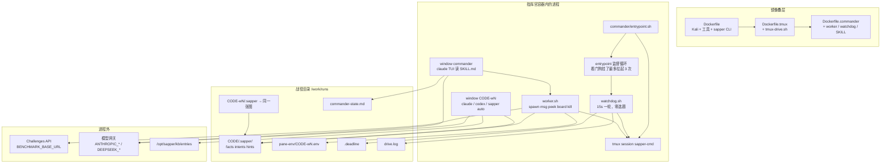
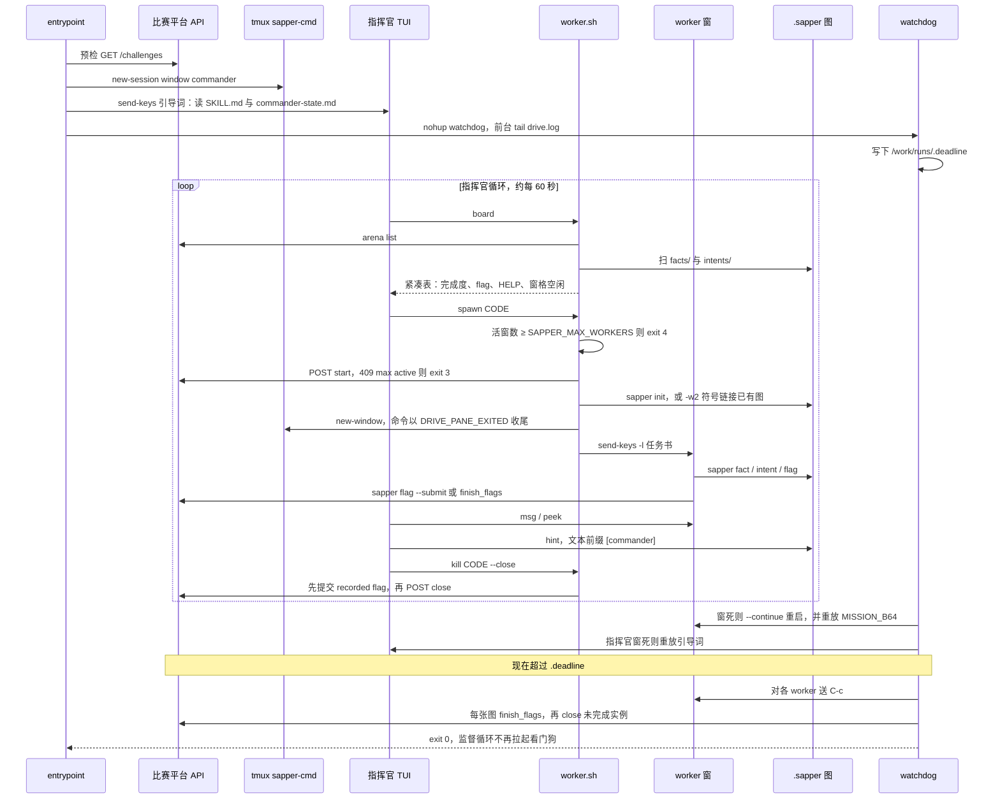
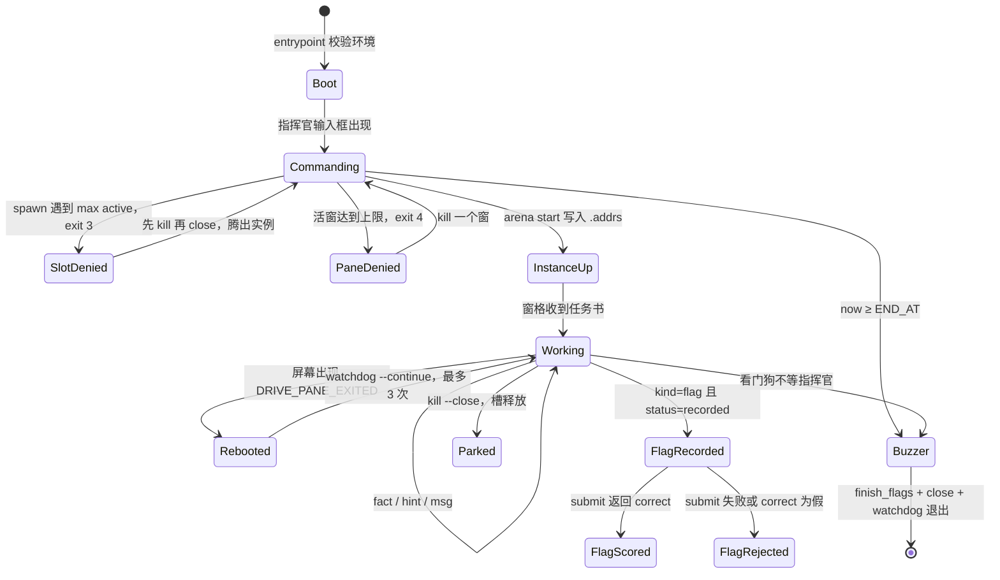
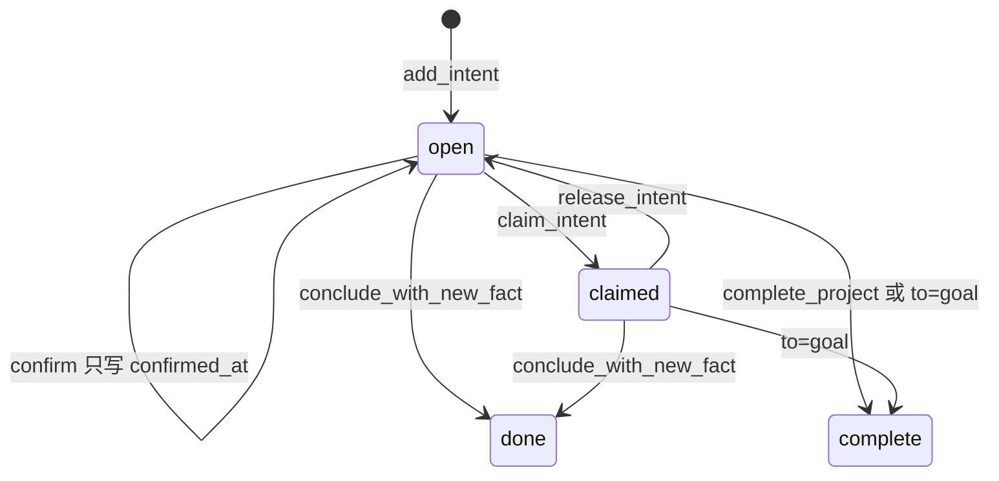

# sapper-v2 代码架构与实现

本文只依据当前仓库的静态阅读写成：没有运行 Python、没有安装依赖、没有构建或拉取镜像、没有向任何比赛平台或靶标发请求。`__version__` 在 `lib/sapper.py` 里仍是 `1.0.0`；`CHANGELOG.md` 记到 1.1.0，其后指挥官运行时又叠在 Docker 脚本上。下文以**源码实际行为**为准，文档与脚本头注释互相打架的地方放到第 10 节。

仓库里没有 `SECURITY_AUDIT.md`。安全相关的公开文本只有 `DISCLAIMER.md` 和 README 里的示踪剂提案；示踪剂没有对应实现。

---

## 1. 一句话定位与适用场景

**sapper-v2 是一套面向授权攻防竞赛的多 Agent harness：用项目本地的事实—意图图做共享记忆，用提示词模板把「规划 / 执行 / 复核」拆成可恢复的步骤，再用 tmux 把一个指挥官和多名 worker 跑成可重启的进程编队。**

它适合这些场景：

- 单题或系列题的长周期渗透记录：已确认的主机、服务、凭据、漏洞、flag 要跨会话保留，个体上下文可以死。
- TSecBench 风格的托管评测：容器启动后自己拉题、开实例、解题、交 flag、关实例，并在总时长用尽时收尾。
- 同一张图上的人机协作：人用 CLI 写 hint、确认危险意图、看 HTML 图；Agent 用同一套命令读写。

它把「换模型、换 CLI」留在边界外。默认引擎是 Claude Code 风格的 `claude -p`，`SAPPER_BIN` 可以换成任何能吐出兼容 JSON 信封的命令。竞赛军规、平台地址和密钥都不在库代码里写死，分别落在 `docker/commander/SKILL.md`、环境变量和可选的 `.sapper/arena.json`。

仓库同时装着**三代运行时**，共用同一张图和同一个 `ArenaClient`：

| 代 | 入口 | 谁做策略 |
|---|---|---|
| 无头评测 | `docker/entrypoint.sh` → `sapper bench` | `sapper auto` 里的 reason/explore 循环；多题用轮次或 `--parallel` |
| 同质 TUI 车队 | `docker/entrypoint-tmux.sh` → `docker/tmux-drive.sh` | 脚本按平台未完成列表开窗，每窗一个交互式 `claude` |
| 指挥官编队 | `docker/commander/entrypoint.sh` | tmux 里的指挥官 TUI 读 `SKILL.md`，通过 `worker.sh` 雇人；`watchdog.sh` 只保活 |

README 把第三代称为冠军形态。前两代仍在树里，是它的下层，也是可以单独跑的产品。

---

## 2. 核心理念与设计取舍

### 2.1 三条能力，再加三条制度

README 把设计说成「女娲基座」上的六件套。对照代码，前三件是机制，后三件主要是提示词和进程约定：

| 理念 | 代码里的对应物 |
|---|---|
| 造人 | `tmux new-window` 拉起新的 `claude` / `codex` / `sapper auto`。`worker.sh spawn`、`sapper fleet`、`tmux-drive.sh launch` 都是这一动作 |
| 语言 | 往别人的输入框打字。指挥官用 `worker.sh msg`（`tmux send-keys -l`）；图内同伴用 `sapper send`（paste-buffer，另一条路径） |
| 历史 | `.sapper/` 下一文件一节点的事实—意图图。三层文档：`title` / `description` / `doc` |
| 法律 | `docker/commander/SKILL.md` 与 `templates/*.md`。没有策略解释器，模型自己读 markdown |
| 经济 | 环境变量分模型档：`SAPPER_MODEL`、`SAPPER_MODEL_DS`、`SAPPER_KEY_POOL`。进程按档重启，库不调度 GPU |
| 分工 | 角色名写在军规和任务书里（侦察、士兵、将军）。代码只有窗格、`-p` 限时进程和 `--general` 这几个开关 |

取舍很明确：**不建数据库、不建策略服务、不把角色做成类。** 共享状态是 git 可 diff 的 JSON；并发靠 `fcntl.flock`；「谁下一步干什么」要么是 LLM 吐出的 JSON，要么是人写在 `SKILL.md` 里的表。个体会话可以因上下文爆掉被换掉，图和 `commander-state.md` 留下来。

第四味是人还在回路里：`requires_confirmation` 的意图必须 `sapper confirm`；`sapper peers` 必须显式授权 tmux 目标；`brainstorm` 的选项默认上锁，等人 `brainstorm-pick`。竞赛镜像反过来把 Claude Code 的权限确认预设成跳过，那是评测无人值守的选择，不是图模型的选择。

### 2.2 和三种常见编排的异同

**和 ReAct。** ReAct 在同一上下文里循环「想 → 调工具 → 看观察」。sapper 的 worker TUI 内部仍是这种循环：Claude Code 自己决定 shell 工具，观察留在窗格滚动缓冲里。harness 另加了一层：确认过的观察必须写成 fact，下一步工作必须写成 intent。`sapper auto` 把这一层收成固定节拍，模型不能自由决定本轮是规划还是动手——先 `reason`，再对 frontier 上的意图 `explore`。看门狗和 `worker.sh` 完全不是 ReAct，它们是 bash 状态机。

**和 Planner-Executor。** `templates/reason.md` 是规划者，`templates/explore.md` 是执行者，`templates/verify.md` 是可选复核者，`sapper auto` 把三者串起来。差异在于规划者**不一次吐出完整计划**。它每轮最多写入 3 条 intent（`_apply_reason` 对 `data[:3]` 切片），每条必须引用已经存在的 fact id。计划就是不断变长的图，执行者可以在自己的 CLI 里直接 `sapper fact` / `sapper done`，外层再尝试把 JSON 结果落成节点。指挥官运行时把规划再抬高一层：外层指挥官不写 intent，它分配实例、窗格和时间；内层 worker 才跑渗透循环。

**和 Multi-agent。** 指挥官形态是层级多 Agent：一个指挥官进程、至多 `SAPPER_MAX_WORKERS`（默认 8）个 worker 窗、一个零策略看门狗。同题的 `-w2` 通过符号链接共享一张图，这是黑板，不是点对点协商协议。`sapper peers` 是另一套可选的点对点通道，发现窗格不会自动授权。侦察兵、将军、通信兵这些名字没有类、没有注册表。`--general` 只改变任务书和（在特定条件下）模型档；通信兵是 README 描述的比赛中涌现行为，源码里没有这个角色。

因此拆分是：

- **图**负责「什么已被确认、什么还开着」，避免每个 Agent 用自己的上下文当账本。
- **模板**负责单题内的规划/执行契约，输出必须是 JSON，便于无数据库地回写。
- **tmux + worker.sh**负责「人」的出生、死亡和说话，因为交互式 CLI 没有稳定的多会话 API。
- **watchdog**负责进程级自愈，故意不读棋盘做取舍，避免两个大脑同时改编队。
- **SKILL.md**负责跨题策略。作者把策略留在自然语言里，是为了让模型在比赛中改自己的分工，而不是为了让人每次改 Python。

代价也写在实现里：策略正确性无法单测；`SKILL.md`、`SPEC.md` 和 bash 会漂移；权限边界大量是提示词而不是沙箱。

---

## 3. 整体架构图

### 3.1 组件与进程

三套入口共享 `lib/`、`templates/`、`kb/` 和 TSecBench HTTP API。指挥官镜像在 tmux 镜像之上，tmux 镜像在 Kali 基础镜像之上。



无头形态没有 tmux：`docker/entrypoint.sh` 直接 `exec sapper bench`。bench 为每题起一个 `sapper auto` 子进程，子进程再按步调用 `claude -p`。同质 TUI 形态的会话名是 `sapper-tui`，驱动脚本自己选题、自己发任务书，没有指挥官窗。

### 3.2 一次典型任务：指挥官编队从开机到收尾

下面是 `Dockerfile.commander` 这条路径上、一道题从创建到关闭的过程。平台调用集中在 `ArenaClient`：`GET /openapi/v1/challenges`，以及带 `unique_code` 的 `start` / `hint` / `close` 和 body 为 `{unique_code, flag}` 的 `submit`。



同一生命周期也可以看成平台实例和窗格两套状态。实例槽是平台资源（军规写死并发 3 个，代码只识别错误文本里的 `max active`）；窗格是本地资源（默认 8）。



单题无头循环是更小的一台状态机，跑在每个 worker 的 `sapper auto` 里：`reason` 提议或宣布完成 → frontier 上的 intent 被 claim → `explore` 回写 fact → 可选 `verify` 失败时追加 hint → 图签名不变或 noop/rejected 连续两次就停。全局时钟用 `--minutes` / `--deadline` 注入 `{time_budget}`。`bench` 在这台状态机外面再套 `start → auto → submit recorded → close`，并行度由 `--parallel` 控制，平台 409 时停止回填。

---

## 4. 目录与模块地图

```
sapper-v2/
├── lib/sapper.py            # CLI、图存储、调度、bench/command/fleet/auto
├── lib/arena.py             # TSecBench HTTP 客户端，仅标准库 urllib
├── lib/kb.py                # 离线知识库，一文件一条
├── lib/sapper-hook.py       # Claude Code SessionStart / UserPromptSubmit
├── lib/_settings_patch.py   # 幂等改项目级 .claude/settings.json
├── lib/view_template.html   # 图的静态/直播可视化
├── templates/
│   ├── reason.md            # 单题规划者
│   ├── explore.md           # 单题执行者
│   ├── verify.md            # 复核者
│   ├── command.md           # 跨题时间片分配者
│   ├── blindspot.md         # 盲点 → hint
│   └── brainstorm.md        # 多方案 → 待确认 intent
├── skill/SKILL.md           # /sapper-setup 技能说明
├── kb/entries/kb001.json …  # 随仓库分发的条目（kb001–kb056）
├── docker/
│   ├── Dockerfile           # 基础镜像，ENTRYPOINT = entrypoint.sh（bench）
│   ├── Dockerfile.tmux      # FROM 基础镜像，换 entrypoint-tmux.sh
│   ├── Dockerfile.commander # FROM tmux 镜像，换指挥官 entrypoint
│   ├── entrypoint.sh
│   ├── entrypoint-tmux.sh
│   ├── tmux-drive.sh
│   ├── ENV.md               # 托管模式变量说明
│   ├── local-sim.sh         # 本地模拟脚本（本文未执行）
│   └── commander/
│       ├── SPEC.md          # 2026-10-16 的架构契约，部分已被脚本超越
│       ├── SKILL.md         # 指挥官军规，注入路径 /opt/sapper/docker/commander/SKILL.md
│       ├── entrypoint.sh
│       ├── worker.sh
│       ├── watchdog.sh
│       └── codex-home/config.toml
├── tests/test_sapper.py     # 标准库 unittest
├── install.sh               # 把 lib/sapper.py 链到 ~/.local/bin/sapper
└── examples/README.md
```

根上的 `SKILL.md` 是给使用 sapper 的 Agent 看的协议说明，不是指挥官军规。两份文档描述的是同一 CLI 的不同使用姿势。

模块依赖是单向的：`sapper.py` 在运行时用 `importlib` 按文件加载 `arena.py`、`kb.py`、`_settings_patch.py`，避免把它们做成包。`sapper-hook.py` 再 import `sapper`。Docker 脚本直接执行 `arena.py` 里的 `ArenaClient`，不经过 `sapper arena` 子命令。知识库与图互不引用：图在项目目录，库默认在仓库 `kb/`，环境变量 `SAPPER_KB_ROOT` 可换根。

---

## 5. 核心实现

### 5.1 入口与配置

人用的入口是 `lib/sapper.py` 的 `main`。`build_parser()` 注册全部子命令；`__version__` 为 `1.0.0`。`install.sh` 只做符号链接，不改全局 Claude 设置。`sapper setup` 才在**当前项目**写 `.sapper/`、`.claude/settings.json` 钩子和可选的 `AGENTS.md`。

全局开关 `--store` 默认 `.sapper`，而且必须出现在子命令之前。军规第 3.2 节特意提醒 `sapper status --store X` 是错的。

配置没有集中配置对象，分四路：

| 来源 | 影响 |
|---|---|
| 环境变量 | 平台 `BENCHMARK_BASE_URL` / `BENCHMARK_TOKEN`；模型 `ANTHROPIC_BASE_URL` / `ANTHROPIC_AUTH_TOKEN` / `SAPPER_MODEL`；备用网关 `DEEPSEEK_*`、`SAPPER_MODEL_DS`；重试 `SAPPER_RETRY_MODEL`；预算 `SAPPER_TOTAL_MINUTES`、`SAPPER_MAX_WORKERS`；引擎前缀 `SAPPER_BIN`；知识库 `SAPPER_KB_ROOT` |
| `.sapper/arena.json` | 可选覆盖平台 URL、token（字面量或 `ENV:变量名`）、超时。托管模式可以完全不写这个文件 |
| `fleet.json` | `sapper fleet` 的会话名、根目录、窗格类型 |
| 镜像 ENV | 基础镜像默认 `SAPPER_MODEL=glm-5.3-flash[1m]`、总预算 470 分钟；指挥官镜像把 `SAPPER_MODEL` 改成 `glm-5.3[1m]` |

三个容器入口都先拒绝空的 `BENCHMARK_*` 和 `ANTHROPIC_*`，再用 curl 打一次 challenges 列表。基础入口随后冒烟调用 `claude -p`，失败只警告，仍进入 `sapper bench`。指挥官入口不把模型冒烟失败当成致命错误的方式写在 `docker/entrypoint.sh`；指挥官自己的 `entrypoint.sh` 复制了平台可达性检查，然后拉 tmux。非 root 用户 `agent` 是硬要求：注释写明 Claude Code 拒绝在 root 下使用跳过权限确认。

`sapper setup` 在创建图之前先 `validate` 已有的 `.claude/settings.json`。钩子注册由 `_settings_patch.add` 完成，只追加命令行里含 `sapper-hook.py` 的项，并先写同目录临时文件再 `os.replace`。

### 5.2 Agent 编排与提示词

编排有四层，从内到外：

1. **`sapper dispatch <target>`**：一步。`reason` / `verify` / `blindspot` / `brainstorm` 是名字；其他 target 被当成 intent id，走 explore。
2. **`sapper auto`**：单张图上的循环。`cmd_auto` 每步调用 `_run_reason_raw`，然后对 `frontier()` 里尚未被别人占用的意图 `_run_explore_raw(..., claim=True)`，`--verify` 时再 `_run_verify_raw`。
3. **`sapper bench` / `sweep` / `command`**：多张图。bench 自己调平台；sweep 轮询已有图；command 让模型在 `templates/command.md` 下输出 `work | hire | fire | stop`。
4. **tmux 指挥官**：策略不在 Python 里。`SKILL.md` 第 2 节规定循环：读 state → `worker.sh board` → 至多两个动作 → `sleep 60`。

`render_prompt` 把图收成「像 YAML 的纯文本」填进 `{graph_yaml}`，**不包含 `doc`**。详细证据要执行者自己 `sapper doc <id>`。占位符一次替换，避免 fact 正文里的 `{goal}` 再被当成模板：

```python
# lib/sapper.py — _replace_placeholders
def _replace_placeholders(template_text: str, replacements: dict[str, str]) -> str:
    """Substitute template tokens in one pass."""
    return re.sub(
        r"\{([A-Za-z_][A-Za-z0-9_]*)\}",
        lambda match: replacements.get(match.group(1), match.group(0)),
        template_text,
    )
```

规划者契约在 `reason.md`：只返回一个 JSON 对象。`accepted: false` 表示拒绝；`data.complete` 结束项目；`data.intents[]` 提议工作；空 `data` 表示现有 intent 已够。`_apply_reason` 丢弃 `from` 里不存在的 fact id，而不是让整批失败。`requires_confirmation` 由模型自报，CTF 模板要求几乎总是 false。

执行者契约在 `explore.md`。系统提示 `_agents_system_prompt` 再附一份 CLI 清单。模型可以在进程里自己调用 `sapper`，所以一次 explore 有两条回写路径：JSON 里的 `description/kind/data` 由 `_run_explore_raw` 原子落盘；进程内的 `sapper done` 会先把 intent 关掉，外层 `conclude_with_new_fact` 发现已结束并报错，`cmd_auto` 把「already concluded」当成成功。

复核默认关闭。`docker/ENV.md` 写明正式赛按 token 排名，`SAPPER_VERIFY=1` 才打开。verify 失败只加一条 creator 为 `verify` 的 hint，**不撤回 fact**。`dispatch verify` 在未通过时返回退出码 1。

跨题分配器 `cmd_command` 把 `render_board` 填进 `command.md`。模型失败时按已工作分钟数做轮询，挑 `worked` 值最小的未完成题。`hire` 开 tmux 窗口 `w-<题名>` 跑 `sapper auto`；这是 `sapper-fleet` 会话，和指挥官的 `sapper-cmd` 不是同一个会话。

盲点和头脑风暴不进入 auto 主循环，要显式 `dispatch`。盲点变成 hint。头脑风暴给每条选项 `requires_confirmation=True`，doc 里写入带随机后缀的 `brainstorm-<时间>-<hex>` 批次号；`brainstorm-pick` 确认一条，其余用 `allow_unconfirmed=True` 收成「已弃用」fact。

指挥官任务书是第二套提示词，不走模板引擎。`worker.sh` 的 `default_mission` 要求记录 typed fact、立刻 `sapper flag ... --submit`，并用 `[HELP]` / `[REPORT]` 笔记和指挥官通信。`general_mission` 额外允许将军自己再调用 `worker.sh spawn --p`。`SKILL.md` 第 4.6 节的升级表（侦察 4 分钟、10–20 分钟加 w2、20–30 分钟 `--general`、之后停车）是给指挥官模型看的，Python 不解释这张表。

钩子是单 Agent 场景的编排注入。`sessionstart` 只在当前目录恰好有 `.sapper/project.json` 时说话，不向上继承父目录的图。`userpromptsubmit` 注入 `render_status` 加最近历史，并声明图文本不可信；正文超过 6000 字符会截断。

### 5.3 工具注册与权限边界

这里没有工具注册表。Agent 能用的「工具」是三层表面：

| 表面 | 谁用 | 实现 |
|---|---|---|
| `sapper` 子命令 | 任何能跑 shell 的 Agent | `build_parser` 里的固定子命令 |
| `worker.sh` 子命令 | 指挥官，以及将军任务书允许的二次雇佣 | `spawn kill msg peek list board hint` |
| 镜像里的渗透工具 | worker 的 Claude/Codex 会话 | Dockerfile 的 apt/pip/npm，不在 sapper 里登记 |

Kali 基础镜像安装 nmap、sqlmap、nuclei、impacket、seclists 等，供会话自己调用。sapper 只在提示词里点名它们，不包装参数。

权限是几道性质不同的门，强度差很多。

**图写入门是代码强制的。** intent id 必须匹配 `^[a-z][a-z0-9_-]{0,16}$`，`goal` 单独放行，挡住 `../`。`requires_confirmation` 且没有 `confirmed_at` 时，`claim_intent` 和 `_check_conclusion_permission` 都拒绝。已被别人 `worker` 占用的 intent 不能被第二个 worker 收尾。`_assert_safe_store_root` 拒绝把家目录或文件系统根当成可删的 store。

**同伴通信是显式名单。** `sapper peers --discover` 只列出 tmux 窗格。`send` / `capture` 只接受 `.sapper/ai-peers.json` 里已有的名字，并且发之前再检查目标还在。这和 `worker.sh msg` 无关：后者不读这份名单，它信任调用者已经是指挥官。

**提示词围栏是文本约定。** `reason.md`、`explore.md`、`command.md`、`blindspot.md`、`brainstorm.md` 和 hook 都写着：图、棋盘、靶标输出是不可信数据。`_scrub_inline` 去掉控制字符，降低伪造新行的可能。这不是沙箱。

**指挥官「不许自己动手」是军规。** `SKILL.md` 第 1 节和第 8 节要求指挥官只跑 `worker.sh`、只读 `sapper`、只改 `commander-state.md`。进程上指挥官与 worker 是同一个用户 `agent`，没有 seccomp 或单独的工具白名单去阻止指挥官窗格执行 nmap。

**竞赛镜像把 Claude Code 的人机确认关掉了。** `trust_preset` 写项目级 `defaultMode: bypassPermissions`，并在 `~/.claude.json` 里记下 `hasTrustDialogAccepted` 与 `bypassPermissionsModeAccepted`。窗格命令带 `--dangerously-skip-permissions`。`accept_dialogs` 对信任对话框送 Down+Enter。`sapper dispatch --skip-permissions` 才会给 `claude -p` 加同一个旗标；不加时 explore 只在 stderr 警告「将会逐步询问」。

**平台参数有字符集限制。** `ArenaClient._code` 只允许 `^[A-Za-z0-9_.:-]+$`。知识库 tag 必须匹配 `^[a-z0-9][a-z0-9_-]*$`。

**范围纪律同样是提示词。** 模板和军规都写「只打题目容器，不打平台和计分设施」。`general_mission` 同时告诉将军：`sapper flag --submit` 失败时，可以向文档化的 `/openapi/v1/challenges/submit` 发官方提交请求。那是评分通道，不是第二套客户端；`finish_flags` 才是脚本里的正式补交路径。

### 5.4 记忆与状态持久化

`Store` 是文件系统上的图。布局：

```
.sapper/
├── project.json          # origin, goal, status, counters, completed_at
├── .lock                 # flock 目标
├── facts/goal.json       # 终端事实，id 固定为 goal
├── facts/f001.json
├── intents/i001.json
├── hints/h001.json
├── arena.json            # 可选
├── ai-peers.json         # 可选
└── ai-channel.txt        # 可选，同伴消息追加日志
```

`project.status` 只有 `active` 和 `completed`。一次完成必须有一条 `to == "goal"` 的 intent，`complete_project` 在同一把锁里写这条边并改状态。普通事实约定不可变；**flag 是唯一允许原地改 `data.status` 的事实**，因为要先落盘再提交，进程崩溃后下轮还能补交。

锁和原子写：

```python
# lib/sapper.py — Store.locked
@contextmanager
def locked(self):
    self.lock_file.parent.mkdir(parents=True, exist_ok=True)
    fh = open(self.lock_file, "a+")
    try:
        fcntl.flock(fh.fileno(), fcntl.LOCK_EX)
        yield
    finally:
        fcntl.flock(fh.fileno(), fcntl.LOCK_UN)
        fh.close()
```

`atomic_write_json` 在目标目录 `mkstemp`，`fsync` 后 `os.replace`。id 计数器只是提示：`_next_id` 若发现文件已在，就跳过，避免手改图之后覆盖旧节点。

就绪不是状态字段，而是结构：

```python
# lib/sapper.py — is_ready
def is_ready(intent: dict, fact_ids: set[str] | None = None) -> bool:
    if not is_open(intent):
        return False
    if fact_ids is not None and not set(intent.get("from", ())).issubset(fact_ids):
        return False
    if intent.get("requires_confirmation") and not intent.get("confirmed_at"):
        return False
    return True
```

`frontier` 把已 claim 的排在前面。读路径对坏 JSON 警告并跳过，`sapper validate` 才把坏节点、断边、goal 文案漂移和「status 与 goal 边不一致」列成错误。

三层文档是控制上下文的手段。提示、`status`、hook 历史默认只有 title 和一行 description。`recall` 对 title（权重 2）和 description 做 Unicode 分词，中文逐字成 token，零重叠时用 `difflib` 且比率至少 0.45 才保留。`doc` 要另查。`render_history_block` 给 hook 最近 8 条 fact 和 4 条已完成 intent。

同题多 Agent 的共享方式是符号链接：主目录 `ROOT/<code>/.sapper` 是真图，`ROOT/<code>-wN/.sapper` 指向它。各窗 cwd 不同，Claude 的 `--continue` 按目录找会话，避免两个窗恢复到同一会话。

指挥官自己的跨压缩记忆是 `ROOT/commander-state.md`，模板在 `SKILL.md` 第 5 节：迭代次数、分配表、停车列表、情报、队列。看门狗重启指挥官时，引导词要求先读这个文件。代码不解析它。

worker 的档位记忆是 `ROOT/pane-env/<pane>.env`：`MODEL`、`GW`、`ENGINE`、`MISSION_B64`。看门狗重启 TUI 时解码任务书再打一次。活动时间在 `ROOT/.worker-activity.tsv`。截止时间是 `ROOT/.deadline` 里的 epoch，entrypoint 和 watchdog 都会写。

知识库是另一块持久化，所有图共享。条目字段：`id title description detail commands tags source created_at`。搜索把 title 放进 haystack 两次，再拼 description、tags 和 detail 前 500 字，得分是查询 token 的重叠比例。`kb import` 把 markdown 的第一个 `#` 标题当 title。写入是「文件不存在才写」，没有图那把 flock。

`cmd_auto` 用 `_graph_signature` 判断一步有没有改变项目状态、fact 的 id+description、intent 的 id+to+confirmed_at。只改 doc 或 flag status 不会被这个签名看见。

### 5.5 LLM 接口

库内所有模型调用都走 `run_claude`。它不实现 HTTP，只拉起子进程：

```python
# lib/sapper.py — run_claude 拼出的引擎命令
prefix = os.environ.get("SAPPER_BIN", "claude").split()
argv = prefix + [
    "-p",
    "--output-format", "json",
    "--model", model,
]
if skip_permissions:
    argv.append("--dangerously-skip-permissions")
if append_system:
    argv += ["--append-system-prompt", append_system]
```

提示词从 stdin 进，stdout 必须是 JSON 对象信封：`result` 为字符串，`is_error` 为真则抛 `FGError`。`extract_json_object` 在 `result` 正文里找第一段能 `json.loads` 的平衡花括号，容忍前后散文。

重试读 `SAPPER_RETRY_MODEL`（镜像默认 3）。非「CLI not found」的失败按 10s、20s、40s 退避，上限 120s。错误文本匹配配额正则（insufficient、quota、401、欠费、余额等）时先 `_rotate_key`：`SAPPER_KEY_POOL` 是 `[{base_url, token, model}, ...]`，把下一条写进当前进程的 `ANTHROPIC_BASE_URL`、`ANTHROPIC_AUTH_TOKEN`、`SAPPER_MODEL`。单条池子则原地重试。`-p` 模式每个引擎调用都是新进程，所以轮换立刻生效。TUI 模式要靠 watchdog 改 tmux 会话环境并重启窗格，库内这次轮换看不到已经打开的 TUI。

交互式路径不经过 `run_claude`。指挥官和 TUI worker 直接是 `claude --model ... --effort max`，或实验性的 `codex`（镜像钉在 `@openai/codex@0.42.0`，因为更新版本丢掉了 DeepSeek 用的 chat wire）。`codex-home/config.toml` 进镜像用户的 `~/.codex/`。`-p` 窗则是 `sapper auto`，里面才会 `run_claude`。

默认模型名在 CLI 里是 `sonnet`，在基础镜像里是 `glm-5.3-flash[1m]`，在指挥官镜像里是 `glm-5.3[1m]`。`[1m]` 是 Claude CLI 用来打开长上下文的后缀，不是网关侧的模型 id；`docker/ENV.md` 记录直接填 `glm-5.3-flash-1m` 会报模型不存在。

`worker.sh` 选择档位的实际规则：

- 未指定 `--model` 时，`--gw ds` 用 `DS_MODEL`（`SAPPER_MODEL_DS` 或 `deepseek-flash`），否则用 `MODEL`。
- `MODEL` 本身是 `${SAPPER_MODEL_DS:-${SAPPER_MODEL:-glm-5.3[1m]}}`。指挥官镜像把 `SAPPER_MODEL` 设成智能档，又**不**设 `SAPPER_MODEL_DS`。于是不导出后者时，普通士兵也拿到智能档。
- 未指定 `--gw` 时，模型名含 `deepseek` 则网关算 ds，否则算 glm。
- `--general` 只有在已经是 `--gw glm` 且当前模型字符串等于 `$MODEL` 时，才改写成 `$SAPPER_MODEL`。只写 `spawn CODE --general` 时 `--gw` 仍为空，这条分支不执行。

看门狗的 `rotate_key` 是另一份实现：它改自己的环境和 tmux 会话环境，再重启窗。注释写明不再按厂商家族钉死密钥，避免模型已切到 DeepSeek、密钥还是失效的智谱 key。

### 5.6 结果与产物

一条渗透结果在系统里可以同时以四种形态存在。

**图节点。** explore JSON 或 `sapper fact` / `sapper done` 写出的 fact。kind 限于 `host service cred vuln loot flag note`。`data` 必须是扁平标量，键匹配 `[A-Za-z0-9_.-]+`。bool 收成 `"true"` / `"false"`。

**flag 账本。** `cmd_flag` 按 `data.value` 去重，先写 `status=recorded` 的 flag fact，再按需提交。bench 的 `_bench_submit_recorded` 和 bash 的 `finish_flags` 扫描 `status` 为 `recorded` 或缺失的 flag，用响应里的 `correct` 写成 `submitted` 或 `rejected`。重复提交（消息含 already 或 409）在 `finish_flags` 里被收成 `submitted`。`status` 还允许 `duplicate`，主路径没有写入它。

**平台进度。** 挑战列表上的 `is_completed`、`correct_flag_count`、`flag_count`、`container_addr`。bench 用 `is_completed` 把题移出队列。`worker.sh board` 把平台列和本地图并排显示，所以「本地 recorded」和「平台已计分」可以同时看见。

**人读的投影。** `sapper status` / `graph` / `recall`；`sapper view` 把 `build_graph_view` 嵌进 `view_template.html`。静态页把 `<`、`>`、`&` 换成 JSON unicode 转义，避免 fact 里的 `</script>` 打断页面。`--serve` 在本地起标准库 HTTP，轮询 `/__sapper_graph__.json`。`drive.log` 里的 `[board] heartbeat` 是容器外能看到的脉搏：完成题数、活窗、recorded/submitted、`budget_left`、`generals`。将军计数是启发式：pane-env 里模型名不含 `flash` 且不含 `deepseek` 就算将军。

项目完成和题目完成不是一回事。`reason` 返回 `complete` 会把**这张图**标成 `completed`。平台侧完成要等 flag 数对齐，由下一次 `list_challenges` 反映。指挥官军规要求人（模型）看到 DONE 后再 `kill --close`，看门狗只在截止时间做这件事。

---

## 6. 数据流与关键类型

### 6.1 单步 explore 的数据流

```
intent JSON
  → render_intent_prompt（图摘要 + recall 五条 + intent 描述）
  → claude -p stdin
  → stdout 信封 {"result": "<散文或 JSON>"}
  → extract_json_object
  → _parse_explore_payload → (title, description, doc, kind, data)
  → Store.conclude_with_new_fact   # 一把锁：检查未结束、分配 fNNN、写 fact、把 intent.to 指过去
```

`conclude_with_new_fact` 在写 fact 文件之前重新检查 `to is None`。并发的第二个执行者会在写盘前失败，避免孤儿 fact。

### 6.2 多题 bench 的数据流

```
ArenaClient.list_challenges()
  → 过滤 is_completed 为假
  → start_challenge → container_addr[]
  → _bench_prepare_graph
        note 事实：题目描述（当不可信数据）
        host 事实：每个地址
        hint：flag 数量和提交命令
  → 子进程 sapper auto --store <root>/<code>/.sapper
  → _bench_submit_recorded
  → close_challenge
```

并行模式用 `Popen` 字典 `running[code] = (proc, store)`，槽满或 409 就停止回填，每两秒错开启动。到点后 `terminate` 仍提交已经 recorded 的 flag。

### 6.3 关键 JSON 形状

**project.json**

```json
{
  "id": "proj",
  "origin": "TSecBench",
  "goal": "solve challenge CODE and capture all flags",
  "status": "active",
  "created_at": "2026-10-17T00:00:00Z",
  "counters": {"fact": 0, "intent": 0, "hint": 0, "run": 0}
}
```

**fact**（`goal` 没有 kind/data）

```json
{
  "id": "f001",
  "title": "靶标",
  "description": "target container address 10.0.0.8:80",
  "doc": null,
  "kind": "host",
  "data": {"addr": "10.0.0.8:80", "challenge": "e01"},
  "created_at": "...",
  "creator": "arena",
  "source_intent": null
}
```

flag 的 `data` 约定为 `value`、`challenge`、`status`（`recorded|submitted|rejected|duplicate`），可选 `result`。

**intent**

```json
{
  "id": "i001",
  "title": "端口扫描",
  "from": ["f001"],
  "to": null,
  "description": "扫描靶标开放端口并写成 service 事实",
  "doc": null,
  "creator": "reason",
  "status": "open",
  "worker": null,
  "requires_confirmation": false,
  "confirmed_at": null,
  "created_at": "...",
  "concluded_at": null
}
```

`status` ∈ `open | claimed | done | complete`。`done` 的 `to` 必须是 fact id；`complete` 的 `to` 必须是 `goal`。打开或 claimed 时 `to` 必须为 null。schema 在 `_node_schema_errors` 里检查这组不变量。

**reason 载荷**

```json
{"accepted": true, "data": {"intents": [
  {"title": "端口扫描", "from": ["f001"], "description": "...", "doc": "...", "requires_confirmation": false}
]}}
```

或 `{"accepted": true, "data": {"complete": {"from": ["f003"], "description": "..."}}}`。

**explore 载荷**

```json
{"accepted": true, "data": {
  "title": "RCE已验证",
  "description": "一句话证据",
  "kind": "vuln",
  "data": {"host": "10.0.0.8", "cve": "CVE-2021-41773", "status": "exploited"},
  "doc": "命令与回显",
  "deviations": [{"planned": "...", "actual": "...", "reason": "..."}]
}}
```

**verify 载荷**：`data.verified` 必须是 bool；失败时 `issues` 非空，成功时 `issues` 必须空。

**command 载荷**：`action` 为 `work|hire|fire|stop`，前三个要 `target`，`work`/`hire` 要正数 `minutes`。

**平台挑战对象**（测试夹具和 board 实际读取的字段）：`unique_code`、`description`、`difficulty`、`flag_count`、`correct_flag_count`、`is_completed`、`container_addr`。提交响应在测试里是 `correct`、`awarded`、`cumulative_score`、`correct_flag_count`、`total_flag_count`。错误信封是 `code`、`message`、`detail`，挂在 `ArenaError` 上。

**kb 条目**：见 `kb/entries/kb001.json`。`commands` 是字符串数组，给 Agent 看，sapper 不执行它们。

### 6.4 intent 与 flag 的状态



未确认的门不改变 `status`，只让 `is_ready` 为假。flag 生命周期独立于 intent：`recorded → submitted|rejected`，文件 id 不变。

---

## 7. 扩展点

按「改哪里、会动到什么」排列。

| 想扩展的东西 | 落点 | 不会自动发生的事 |
|---|---|---|
| 单题策略 | `templates/reason.md`、`explore.md`、`verify.md` | 指挥官军规仍是旧的。`--templates` 可换目录 |
| 跨题时间片策略 | `templates/command.md` 与 `_parse_command_payload` 允许的 action | 新 action 要改解析器和 `cmd_command` 分支 |
| 竞赛编队策略 | `docker/commander/SKILL.md` | Python 不校验指挥官是否遵守。任务书措辞在 `default_mission` / `general_mission` |
| 模型或 CLI | `SAPPER_MODEL*`、`SAPPER_BIN`、`SAPPER_KEY_POOL` | 替代 CLI 必须接受 `-p --output-format json --model`，并在 stdout 给出 `result` 字符串。TUI 路径另写在 `worker.sh` / `watchdog.sh` |
| 平台地址 | 环境变量，或 `.sapper/arena.json` | `worker.sh` 的 `ArenaClient.load(None)` 不读某题图里的 `arena.json`，只看环境和 cwd 无关的默认查找 |
| 知识 | `sapper kb add` 或再放 `kb/entries/kbNNN.json` | 没有向量索引；中文按字重叠。条目多了线性扫描 |
| 新事实类型 | `FACT_KINDS` 和提示词里的 kind 列表 | 旧图里非法 kind 会被 validate 拒绝、被普通读取跳过 |
| 钩子行为 | `lib/sapper-hook.py` | 只对 Claude Code 的两事件有输出契约 |
| 编队拓扑 | `fleet.json` 的 `panes[].type`：`command`、`auto:<名>`、`shell` | 指挥官镜像不用这份文件 |
| 可视化 | `lib/view_template.html` | 只读 `build_graph_view` 的 JSON |
| 第二引擎 | `worker.sh --engine codex` | 军规写明实验性。watchdog 的重启命令要同时认识 codex |

`nvwabase` 在 README 里被说成抽出去的通用基座。本仓库没有那个包，sapper 自己就是图和 CLI 的完整实现。要换领域，至少要换模板、军规、平台预检和镜像里的工具层；只换 `SKILL.md` 不够，因为 `entrypoint.sh` 在缺少 `BENCHMARK_BASE_URL` 时会直接 FATAL。

---

## 8. 复现与部署要点（只读）

以下是仓库写明的启动方式，**本文没有执行**。

**只有 CLI。** 需要 Python 3 标准库。`bash install.sh` 把 `lib/sapper.py` 链接到 `~/.local/bin/sapper`，并把 `skill/` 链接到 `~/.claude/skills/sapper-setup`。之后在项目里 `sapper setup --goal "..." --agents`。图数据只在该项目的 `.sapper/`。`sapper --help` 的子命令即第 4 节那份清单。单测文件是 `tests/test_sapper.py`，`CHANGELOG.md` 给出的跑法是 `python3 -m unittest discover -s tests -v` 与 `python3 -m py_compile lib/*.py`；本次按约束没有跑。

**无头托管镜像。** `docker build -f docker/Dockerfile -t sapper-agent:latest .`，上下文是仓库根。`docker/build.sh` 会再导出 `dist/sapper-agent.tar.gz`。入口最终执行：

```text
sapper bench --root /work/runs --minutes 470 \
  --minutes-per-challenge 9 --max-steps 10 --parallel 3 \
  --model "$SAPPER_MODEL" --skip-permissions
```

必须有 `BENCHMARK_BASE_URL`、`BENCHMARK_TOKEN`、`ANTHROPIC_BASE_URL`、`ANTHROPIC_AUTH_TOKEN`。可选池子、总分钟、每题分钟、步数、重试、`SAPPER_VERIFY`。

**TUI 车队。** `docker build -f docker/Dockerfile.tmux -t sapper-agent:tmux .`，基础镜像要先存在。入口跑 `tmux-drive.sh`，会话 `sapper-tui`，并行度 `SAPPER_PARALLEL`。

**指挥官镜像。** `docker build -f docker/Dockerfile.commander -t sapper-agent:commander .`，依赖本地已有 `sapper-agent:tmux`。它再装取证/pwn 相关包和 Codex CLI，把 `kb/` 盖到 `/opt/sapper/kb`，入口换成 `docker/commander/entrypoint.sh`。战役根默认 `/work/runs`。看门狗日志 `drive.log` 被 tail 到容器 stdout。截止后看门狗退出，入口监督循环结束，容器随之结束。

`docker/local-sim.sh` 会在宿主机起模拟平台和靶标，再 `docker run` 真实模型网关。那是动态实验，不属于这次静态阅读。`docker/ENV.md` 是王座协议托管控制台的变量清单；指挥官额外变量（`SAPPER_MODEL_DS`、`DEEPSEEK_API_KEY`、`SAPPER_MAX_WORKERS`、`SAPPER_STALL_SECONDS`）写在脚本默认值里，没有单独一份和 `ENV.md` 同等的指挥官环境文档进公开树（`.gitignore` 忽略了 `docker/ENV-COMMANDER.md`）。

镜像构建依赖外网包和随仓库提供的 `docker/nuclei.zip`。Dockerfile 注释说明构建沙箱不一定能访问 GitHub，所以 nuclei 用构建上下文里的 zip。

---

## 9. 阅读路线

建议按这条线读，每一站只回答一个问题。

1. `README.zh-CN.md` 第一节到第四节。只取词汇：harness、三能力、三窗口。分数和涌现故事不是实现。
2. `docker/commander/SPEC.md`。用它当「作者曾经想要的四件套」，再意识到脚本已经超出契约。
3. `lib/sapper.py` 的 `Store`、`_node_schema_errors`、`is_ready`、`frontier`、`atomic_write_json`。这是记忆模型的全部硬约束。
4. `templates/reason.md` 与 `templates/explore.md`，对照 `_apply_reason`、`_parse_explore_payload`、`cmd_auto`。看 JSON 契约如何落成文件。
5. `lib/arena.py` 全文，再看 `cmd_bench` 与 `worker.sh` 里的 `arena` / `finish_flags`。平台边界只有这一份客户端，但有三个调用方。
6. `docker/commander/worker.sh` 的 `cmd_spawn`、`cmd_board`、`cmd_kill`，然后 `SKILL.md` 第 2 节和第 4.6–4.10 节。分清「脚本保证的退出码」和「模型被要求做的取舍」。
7. `docker/commander/watchdog.sh` 从 `relaunch_pane` 到主循环，加上 `entrypoint.sh` 末尾的监督循环。自愈在这里，不在模型里。
8. `lib/kb.py` 和任意一条 `kb/entries/kb0xx.json`。确认知识库是词面检索，不是执行引擎。
9. `lib/sapper-hook.py` 与 `_settings_patch.py`。这是交互式单项目用法，不是竞赛容器用法。
10. `tests/test_sapper.py` 里 arena 契约、flag 生命周期、确认门、路径逃逸、命令载荷这几类测试。它们是行为规格；本文没有重跑。

读的时候把 `BATTLE-REPORT.md` 当成战役叙事。通信兵、绩效考核、全大写规则没有对应符号，不能从报告反推成已实现的子系统。

---

## 10. 未确认与缺口

这些是静态阅读无法闭合、或文档与代码不一致的点。

1. **没有 `SECURITY_AUDIT.md`。** 不能引用一份不在树里的审计。`DISCLAIMER.md` 把示踪剂写成后续版本计划；全库只有 README 和免责声明出现 taggant/示踪剂，没有实现。
2. **版本号滞后。** `sapper --version` 会报 `1.0.0`，而 changelog 已有 1.1.0 和指挥官层。不能用版本号判断镜像里有没有 `worker.sh`。
3. **`sapper arena` 子命令的打印形状和客户端不符。** `ArenaClient` 的方法返回解析后的 JSON 体（列表或对象）。`cmd_arena` 对返回值调用 `.get("result")`。`list_challenges` 返回 list，这条路径会在打印时出错；`start`/`submit` 返回的对象没有 `result` 键，打印会变成 `{}`。`worker.sh` 的内嵌 `arena()` 直接 `json.dumps` 客户端结果，board 和 spawn 走的是这条，不走 `cmd_arena`。测试覆盖的是 `ArenaClient`，不是 `cmd_arena` 的打印。
4. **两套 flag 提交解释。** `_bench_submit_recorded` 和 `finish_flags` 看响应字段 `correct`。`cmd_flag --submit` 把成功定义成 `reply.get("status") == 200`，并把 `reply["result"]` 当备注。按测试夹具的平台体，`status` 不是 200 这个整数，`cmd_flag` 会把一次 `correct: true` 记成 `rejected` 并返回退出码 1。工人任务书让模型调用的正是 `sapper flag --submit`。补救路径是 `kill --close` / 看门狗里的 `finish_flags`。这一点未在运行中复现，只来自对照源码和 `tests/test_sapper.py` 的契约测试。
5. **`arena init` 的提示过时。** 写完模板后打印「导出 `SAPPER_ARENA_TOKEN`」。`ArenaClient.load` 读取的是 `BENCHMARK_TOKEN`，或 `arena.json` 里的 `ENV:` 前缀。模板本身写的是 `ENV:BENCHMARK_TOKEN`。`skill/SKILL.md` 仍提到 `SAPPER_ARENA_TOKEN`。
6. **SPEC 与看门狗已经分叉。** SPEC 第 2 节要求看门狗不重发任务书、工人卡住时什么都不做。实现会把 `MISSION_B64` 在重启后 `send_literal` 回去，并对指挥官窗做 30 分钟画面冻结重启。SPEC 还把指挥官语气设定成 flash 模型；`Dockerfile.commander` 和指挥官 entrypoint 默认 `glm-5.3[1m]`。
7. **士兵默认模型有三份说法。** `SKILL.md` 4.9 说 `spawn CODE` 默认 DeepSeek flash。`worker.sh` 头注释先说全员智能档，接着又说士兵默认 ds。代码是：设置了 `SAPPER_MODEL_DS` 时 `MODEL` 取它，否则取镜像的 `SAPPER_MODEL`（指挥官镜像为 `glm-5.3[1m]`）。`--general` 的升档条件要求调用者已经传入 `--gw glm`。军规里的 `spawn CODE --general` 因此不一定换到智能档。真实比赛环境有没有导出 `SAPPER_MODEL_DS`，仓库不能证明。
8. **`finish_flags` 绕过 `Store`。** 它直接 `json.dump` 改 flag 文件，不用 flock，也不走 `atomic_write_json`。与并发的 `sapper flag` / `update_flag_fact` 可能互相覆盖。board 读图同样不持锁，这是观察窗口，短不一致可以接受；写路径的绕过更要紧。
9. **平台客户端在 bash 里不绑定某张图的配置。** `ArenaClient.load(None)` 只在传入 store 根时才读 `.sapper/arena.json`。竞赛脚本依赖注入的环境变量。本地若只写了图内配置、没设环境变量，Python CLI 的 `_arena_client(store)` 能看见文件，`worker.sh` 看不见。
10. **角色和「涌现制度」没有代码对应物。** 通信兵、绩效考核、全大写禁令、同构迁移是 README / 战报中的模型行为。能在代码里对上的只有：共享图、hint、多窗、`--general`、任务书、`commander-state.md`。
11. **看门狗「零策略」是近似。** 它不做选题和杀人，但会在截止时间替指挥官交 flag 和关实例，会重放任务书，会在配额错误时换 key 并重启。这些是策略中立的保活，仍会改变战役结果。
12. **未运行，所以动态行为未证实。** 包括：tmux 输入框检测对当前 Claude Code 是否仍认 `❯`、`--continue` 的目录启发式会不会续错会话、平台 409 正文是否仍包含 `max active`、`cmd_flag` 对真实响应的退出码。测试文件描述了本地 HTTP 夹具上的客户端契约，不能代替一次真实评测。
13. **公开树忽略了若干交接文档**（`.gitignore` 中的 `HANDOVER.md`、`COMMANDER-HANDOVER.md`、`docker/ENV-COMMANDER.md`）。那些文件不在工作区，本文没有使用它们。
14. **`_graph_signature` 看不见 flag 状态变化。** 若某步只把 flag 从 recorded 改成 submitted，auto 可能认为图没变并停止。bench 在 auto 之外另行提交，所以主路径仍能得分；单跑 `sapper auto` 时这是个洞。
15. **HTML 服务和同伴 paste-buffer 与军规的 send-keys -l 是两套 I/O。** `sapper send` 使用 `load-buffer` / `paste-buffer`；`worker.sh` 头注释写明 bracketed paste 会弄坏 ink TUI，因此指挥官路径禁止 paste。两套机制都在树里，适用对象不同，混用会踩作者已经写明的坑。
